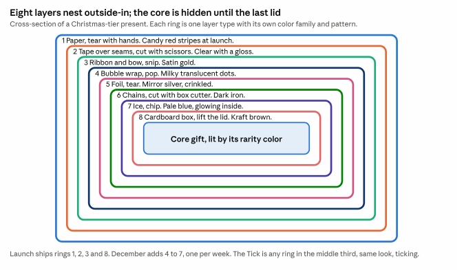
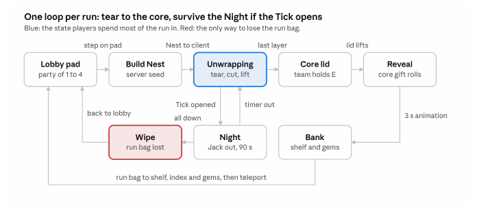

# Art bible

The text of Art bible A and B lives in [PLAN.md](../PLAN.md#art-bible-a-pillars-tiers-the-present) so
there is one copy. This page collects the images.

## Present cross-section

## Run flow

## Systems architecture

## Still to export from the plan doc

- `lobby.png` — lobby plan, 7 zones, spawn facing the pads
- `timeline.png` — build timeline, 7 phases, 2 gates
- `palette.png`, `loot-sheet.png`, `ui-sheet.png` — made during Phase 5

## References

Study-only screenshots go in [refs/](refs/), named by what they show. Never used as textures.
