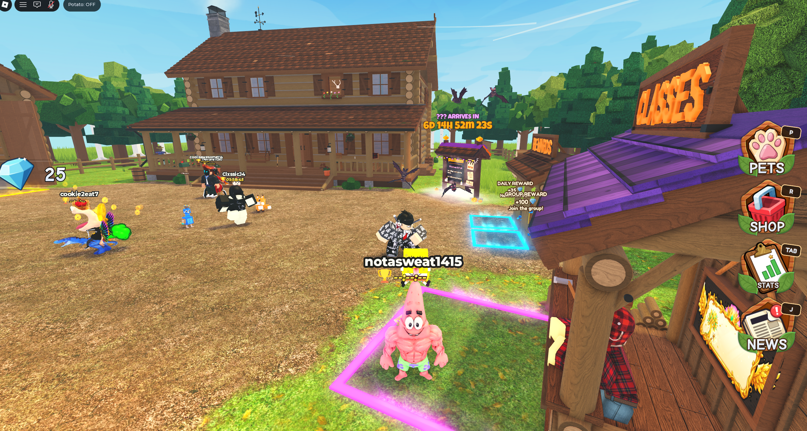
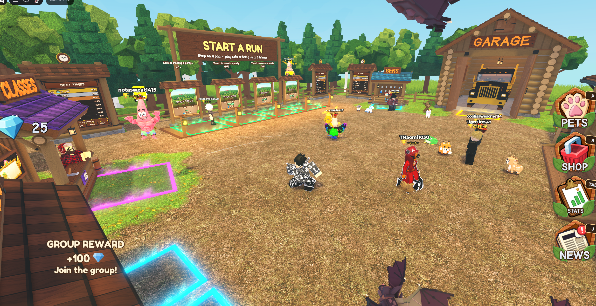
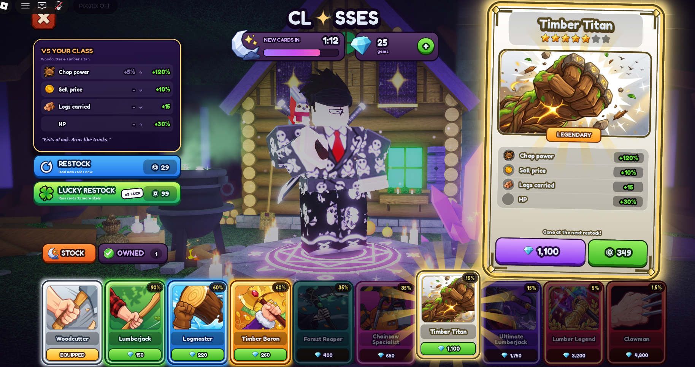
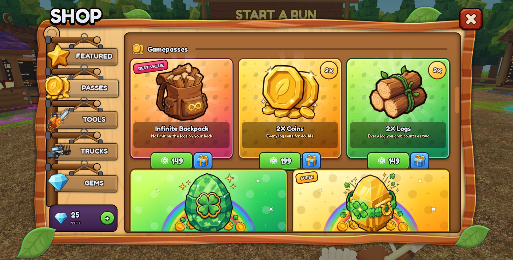
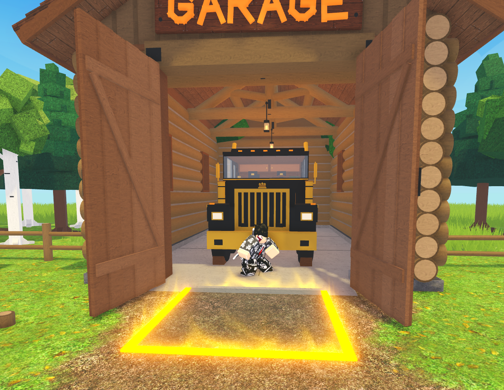
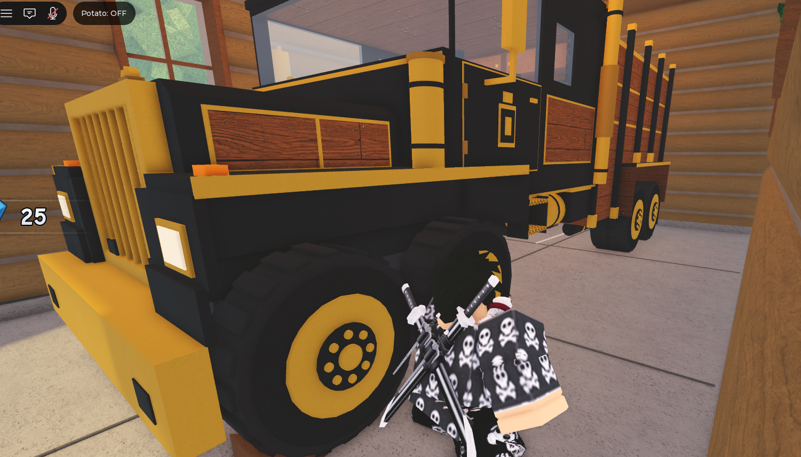
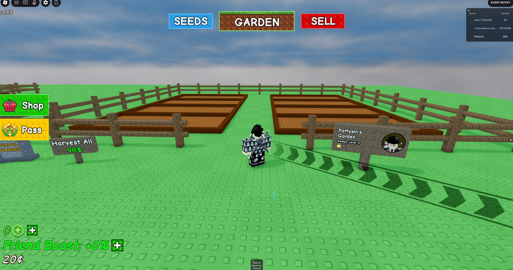

# Art bible

This page maps the canonical art rules and explains the supplied visual references for Phase 5.
The guidance below interprets that direction; PLAN.md rules and PLAN-TABLES.txt numbers still win.

- **Rules** (pillars, studs rule, UI style, icon rules): [PLAN.md](../PLAN.md#art-bible-a-pillars-tiers-the-present)
- **Numbers and drawings:** [PLAN-TABLES.txt](../PLAN-TABLES.txt)
  - Table 11: three visual tiers
  - Diagram C: present cross-section, ring by ring
  - Table 12: layer palette, rarity colors, loot style, mutations
  - Diagram D: lobby plan (Unwrapping Plaza, revised 2026-10-18) and run room
  - Table 13: HUD and UI style
  - Table 14: VFX list and the 24-clip SFX set
  - Table 15: performance budgets

## Images

The PNGs are illustrations exported from the planning doc; PLAN-TABLES.txt wins on any disagreement.
The first three exports (cross-section, run flow, architecture) were deleted because they no longer
matched it; Diagrams A, B and C in PLAN-TABLES.txt replace them.

Still to make in Phase 5: `palette.png`, `loot-sheet.png`, `ui-sheet.png`.

Every placeholder in the game, its image slot and the final that replaces it: [assets.md](assets.md).

## References

Study-only screenshots go in [refs/](refs/), named by what they show. Never used as textures.

### Read before designing Phase 5

Inspect the environment references, the relevant UI references and the negative reference below,
then read Art bibles A/B and the relevant tables above.
The target is simple, chunky Roblox art with a complete, welcoming environment and a clear visual
identity for Unwrap A Present. Simple geometry is the construction method, not permission to leave
greybox buildings, empty fields or generic flat menus as the finished art.

### Positive references: construction and finish

Use these user-supplied Chop a Forest screenshots to understand:

- **Shape:** broad, readable silhouettes; thick posts and frames; substantial roofs; simple trim;
  blocky foliage built in layers. A small set of purposeful forms creates the detail.
- **Materials:** visible wood, roof and ground variation makes simple shapes feel finished.
  In our game use the permitted Roblox stock materials. Smooth means no stud relief, not that every
  surface must be blank SmoothPlastic. Preserve the existing custom-texture restrictions.
- **Composition:** consistent construction across buildings, signs and booths; landscaping frames
  the playable area; destinations remain recognizable from a normal player camera.
- **Light and color:** warm daylight, readable shadows, natural supporting colors and selective
  saturated accents. The present and its reveals must remain the strongest visual focus.
- **UI:** large illustrated buttons, bold readable labels, clear outlines and dimensional frames.
  Apply the documented wooden-panel style consistently across every existing screen.

Do not reproduce the reference map, cabin facade, garage, forest theme, booth lineup, roof colors,
icons, logos, signs or exact UI composition. Do not import or extract its assets. These images show
an approach to shape, material and finish, not a design to trace.

### Translate the approach into Unwrap A Present

- **Lobby:** Unwrapping Plaza, below. It replaced the first pass's fenced field on 2026-10-18; do
  not restore that layout.
- **Environment:** finish existing structures with purposeful depth, trim and restrained planting
  or boundary dressing. Keep routes, shelves and signs clear. Decoration adds no new rooms,
  destinations, interactions or features, and must stay within the performance budgets.
- **Run room:** retain the quiet warm-wood interior, wide window and corner shop in the plan. Give
  those existing elements a finished material and construction treatment. Keep the floor around
  the hero present clear for tearing, lid cover and Jack; do not fill it with decorative clutter.
- **Present:** glossy patterned paper, readable seams and tape, substantial ribbon and bow, and
  recognizable cardboard beneath. Use the documented palette and six paper patterns. Establish
  scale and contrast through the present itself, rather than competing environmental spectacle.
- **Gifts:** use the documented chunky toy proportions, rarity colors and mutation treatment.
  Give each gift a recognizable silhouette; a labeled colored block is still a placeholder.
- **UI:** design our own Shelf, Shop, Classes, Rewards, HUD, bank and reveal treatment using the
  shared wooden framing, rounded bold text and restrained ribbon accents. Use original icons that
  express our functions. Follow our HUD placement and mobile rules, not the screenshot's layout.
- **Night:** retain the same visual identity under the documented darker, colder lighting. Jack
  remains a readable jack-in-the-box with spring and crank, within the approved mild fear direction.

### The lobby: Unwrapping Plaza

Revised direction, 2026-10-18 (DECISIONS.md, "Lobby revamp"; layout and numbers in PLAN-TABLES
Diagram D). It supersedes the old "one open field" Diagram D and the Christmas-only snow.

- **Feeling:** the wonder of opening presents in a snowy village at early winter dusk, with enough
  sky light to see clearly. Cool blue-white snow, warm amber windows and lanterns, and selective
  red, gold and teal gift accents. Welcoming and a little magical; readable shapes, restrained effects.
- **Composition:** a generous round plaza framed by a raised terrace ring, broad steps, snowbanks and
  original buildings. A ribbon inlay crossing the paving makes the plaza the top of a wrapped present
  and draws the route from the spawn to the pads. The signature landmark, an oversized
  half-unwrapped present (lifted lid, big bow, curled paper, a warm glow inside), stands behind the
  Start a Run pads so the destination is obvious from spawn. Space makes atmosphere and places to
  gather, never a longer mandatory walk.
- **Pavilions:** each has its own gift silhouette: Rewards a round hatbox, Classes a tower of stacked
  boxes, Shop an open cardboard box with its flaps as awnings. Never a row of identical stalls.
- **Shelves:** a covered gallery lane off the plaza, shelves facing the lane from both sides, its
  middle clear for the Krampus walk and the steal prompt.
- **Snow:** soft banks and mounds (terrain), uneven runs on roofs, ledges and caps in varied depth;
  never every top covered by the same white slab. Snow is in every tier's lobby; tier decorations
  (balloons, tree, lights, wreath) still mark what a player has unlocked.
- **Setting:** backdrop cottages with lit windows, a fir forest, snow hills and far peaks hazed by the
  atmosphere, so no baseplate edge or empty horizon shows from normal views.
- **Effects:** gentle snowfall, warm lanterns (most glow without a light), a subtle landmark glow,
  occasional drifting paper, tags and ribbon swaying a little, the pads' rims breathing. No constant
  confetti, heavy bloom or many dynamic lights; signs and players stay readable.
- **Never:** Santa, licensed characters or Christmas signage (the setting is festive, the name is
  year-round); studs or bevel dots on the world.

### UI references: hierarchy, cards and screen composition

These additional user-supplied screenshots are enough direction for a first design pass. Do not
wait for more references before working. Interpret their shared visual language through our own
present theme; keep our existing mechanics, prices, odds, class roster and screen entry points.

| Reference | What to study and where to apply it |
|---|---|
| [News panel](refs/chop-a-forest-news-ui.png) | Large title, obvious close button, framed navigation and content hierarchy. Composition reference only; do not add a News feature. |
| [Inventory](refs/chop-a-forest-inventory-ui.png) | Distinct slots, tabs, intentional empty states and a selected-item detail panel. Adapt to Shelf and existing collection information; do not add pets or eggs. |
| [Featured shop](refs/chop-a-forest-shop-featured-ui.png) | Persistent category navigation, readable banners and a contained scrolling content area. Use only categories and offers our game already has. |
| [Pass cards](refs/chop-a-forest-shop-passes-ui.png) | Strong illustration area, short benefit text and a visually separate purchase action. Keep our actual pass benefits and server-provided purchase information. |
| [Tool cards](refs/chop-a-forest-shop-tools-ui.png) | Consistent card anatomy and clear item silhouettes. Apply to our existing run-shop items, without copying weapons, permanent-tool offers or gifting controls. |
| [Gem packs](refs/chop-a-forest-shop-gems-ui.png) | Easily compared pack cards and a clear quantity/price relationship. Use our configured packs; copy no quantities, prices or bonus claims. |
| [Stats](refs/chop-a-forest-stats-ui.png) | Large values, recognizable icons and restrained grouping. Apply this hierarchy to existing reward/progress information; do not add a Stats screen. |
| [Classes](refs/chop-a-forest-classes-ui.png) | A large focused selection screen, illustrated class cards, obvious selected/equipped state and readable perk details. Preserve our spin/ownership/duplicate-refund model; add no stock timer, restock purchase or direct class sale. |

Our Classes screen may occupy most of the screen, with room for selection and perk details. The
reference's step-on-pad entry is not required: retain our existing booth prompt and Classes button.
Do not introduce a special camera scene or pad dependency just to imitate this screenshot.

Use dimensional edges, restrained highlights, clear card boundaries and large touch targets. Keep
our wooden chrome neutral as the plan requires; use existing rarity colors for rarity information.
Do not copy every rainbow card background, leaf decoration, wood texture or exact arrangement.
Use ribbons or gift tags as restrained original accents. Build a mobile composition rather than
shrinking these desktop screenshots, and keep text and buttons live UI elements, not baked images.

### Interior references: simple forms with material depth

Study the thickness of the opening, broad beams, material contrast and daylight entering the space.
Apply that degree of construction and finish to our planned run room. The truck, garage function,
log-cabin facade and exact structure are not part of our game. Keep our wide window, warm wooden
floor, corner shop and open play space; these images do not replace the room specification.

### Artwork placeholders for the first pass

The user accepts simple temporary artwork so implementation can proceed without waiting for final
image generation. Finish screen structure, framing, spacing and interaction styling now; missing
illustrations must not leave the whole screen looking like an unfinished debug panel.

- Use original simple silhouettes or small code-built icons for gifts, gems, tools and classes.
  Retain labels so their meaning does not depend on the illustration. Do not use screenshot crops.
- Keep artwork separate from live labels, prices, odds, buttons and frames. Give image slots a
  consistent aspect ratio and centralize placeholder-to-final asset mappings for easy replacement.
- Final illustrated icons, class cards and banners can be generated later in a shared style:
  chunky cartoon shapes, bold clean outlines, simple shading and gift-themed accents. Do not
  block the first pass on those images or generate entire menu screenshots as runtime artwork.
- Record each temporary asset and its intended replacement in the relevant system README or an
  asset list linked from it. Keep developer placeholder notes out of player-facing UI.
- A functional placeholder is not a completed final asset. Leave dependent final-art criteria and
  the user's deferred testing/performance/playtest checks pending until actually completed.

### Negative reference: repeated studs

This user-supplied Grow a Garden image illustrates the surface treatment to avoid: repeated raised
studs or bevel dots across terrain, fences, structures, signs and UI. Do not use that treatment on
our world, present or interface. Printed paper polka dots are a flat wrapping pattern, not studs.
The existing plan separately prescribes dot relief on toy loot only; these references do not change
that rule or extend it to other surfaces.

### Handoff and remaining design work

Create the palette, loot and UI sheets listed above from our own design as Phase 5 progresses.
Reference screenshots are study material, never runtime assets or shipping textures. Document
asset placeholders and outstanding verification honestly; reference matching does not prove
mobile readability, performance or playtest completion.
