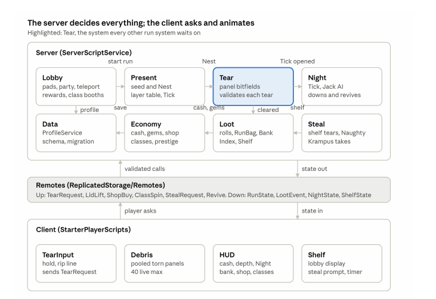

# Systems map

Each system's page is the `README.md` beside its code, so code and docs change in the same diff.

| System | Side | Page | Built in |
|---|---|---|---|
| Lobby | server | [src/server/Lobby](../../src/server/Lobby/README.md) | Phase 3 |
| Present | server | [src/server/Present](../../src/server/Present/README.md) | Phase 1 |
| Tear | server | [src/server/Tear](../../src/server/Tear/README.md) | Phase 0 |
| Night | server | [src/server/Night](../../src/server/Night/README.md) | Phase 4 |
| Loot | server | [src/server/Loot](../../src/server/Loot/README.md) | Phase 2 |
| Economy | server | [src/server/Economy](../../src/server/Economy/README.md) | Phase 3 |
| Steal | server | [src/server/Steal](../../src/server/Steal/README.md) | Phase 6 |
| Data | server | [src/server/Data](../../src/server/Data/README.md) | Phase 2 |
| TearInput | client | [src/client/TearInput](../../src/client/TearInput/README.md) | Phase 0 |
| Debris | client | [src/client/Debris](../../src/client/Debris/README.md) | Phase 0 |
| HUD | client | [src/client/HUD](../../src/client/HUD/README.md) | Phase 3 |
| Shelf | client | [src/client/Shelf](../../src/client/Shelf/README.md) | Phase 6 |
| Shared | both | [src/shared](../../src/shared/README.md) | — |

